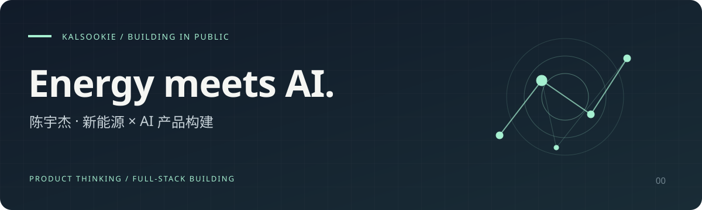

<h1 align="center">Hi, I'm 陈宇杰 · kalsookie</h1>

<b>新能源科学与工程（风能方向）大四 · 华北电力大学（北京）</b> 从真实需求出发，把想法做成可以使用的产品。

<a href="#代表项目">代表项目</a> · <a href="#我在做什么">关于我</a> · <a href="#技术与实践">技术与实践</a> · <a href="#交流与机会">交流与机会</a>

---

## 我在做什么

我正在把新能源领域知识与 AI 应用工程结合起来，独立实践从需求、交互设计、全栈开发到部署的完整产品流程。

目前在做两件事：用 **拾言** 保存与调用个人知识，用 **同频实验室** 探索更自然的校园连接。未来希望将这些产品与工程经验带入储能、风电等能源场景。

## 代表项目

| 项目 | 为谁解决什么问题 | 从这里开始 |
| :--- | :--- | :--- |
| **[拾言 · Shiyan](https://github.com/chen1904818062-ai/shiyan)** | 面向经常与 AI 对话的人，把分散的聊天记录变为可追溯、可修订、可调用的个人记忆。 | [功能与使用](https://github.com/chen1904818062-ai/shiyan#功能一览) · [记忆指南](https://github.com/chen1904818062-ai/shiyan/blob/main/docs/MEMORY_SYSTEM.md) |
| **[同频实验室 · TongPinLab](https://github.com/chen1904818062-ai/tongpinlab)** | 面向高校学生，从性格探索、校园认证到双向匹配，用破冰话题帮助交流开始。 | [产品流程](https://github.com/chen1904818062-ai/tongpinlab#产品如何工作) · [部署指南](https://github.com/chen1904818062-ai/tongpinlab/blob/main/deploy/README.md) |

### 拾言：让每一条记忆都有来处

**对话归档 → 记忆提炼 → 人工确认 → 有来源的问答与复盘**

支持多平台文本导入、多模型配置、证据原文回跳和 Markdown 导出。当前 v1.3.0 已加入个人 AI 记忆系统；默认仅调用已确认的普通记忆，私密内容需单次允许。

### 同频实验室：让认识彼此有一个起点

**32 题性格探索 → 校园认证 → 20 题匹配问卷 → 双向选择与私信**

把社交广场、校园认证与交流放在同一条产品路径中。官方虚拟伙伴提供预设情境练习，并与真人推荐明确区分。

## 技术与实践

| 方向 | 使用与实践 |
| :--- | :--- |
| 产品构建 | 需求梳理、交互设计、移动端体验、完整业务流程 |
| 应用开发 | TypeScript · React · Next.js / Vinext · Node.js |
| 数据与部署 | Drizzle ORM · SQLite / Turso / Cloudflare D1 · Docker · Nginx · Render |
| 专业与工具 | 新能源科学与工程（风能方向）· MATLAB · PLC |

## 交流与机会

**2027 届求职中**，关注 **AI 产品 / AI 应用开发**，尤其是能源 × AI 的应用场景。

欢迎通过 [拾言 Issues](https://github.com/chen1904818062-ai/shiyan/issues) 或 [同频实验室 Issues](https://github.com/chen1904818062-ai/tongpinlab/issues) 交流产品体验、问题与改进建议。

---

New Energy undergrad building AI products · Exploring Energy × AI

